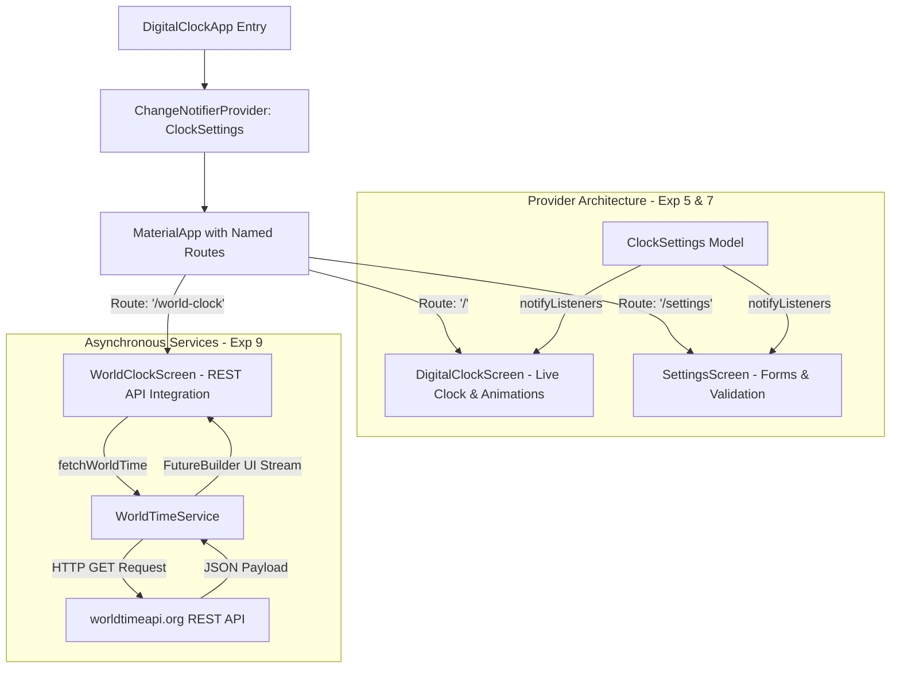
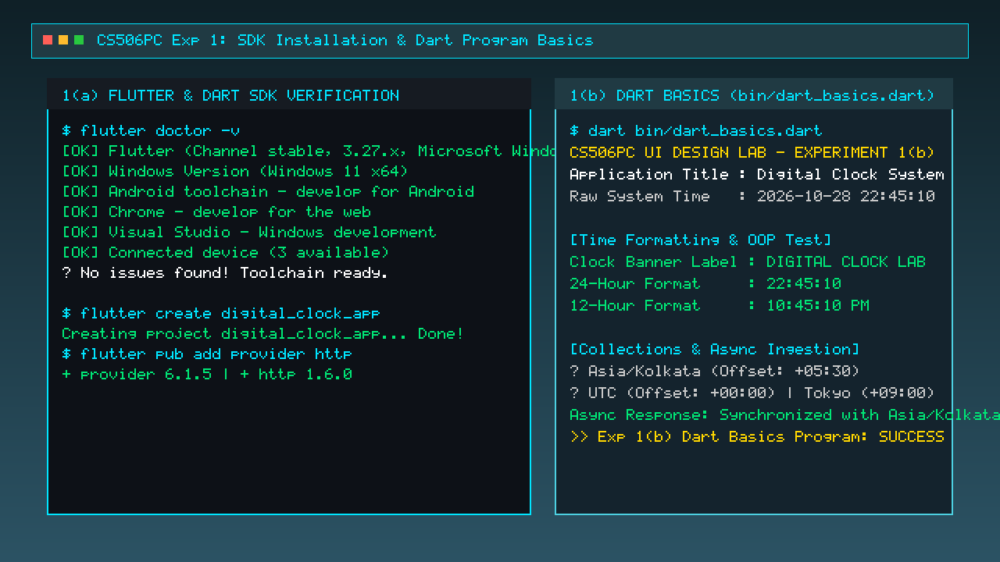
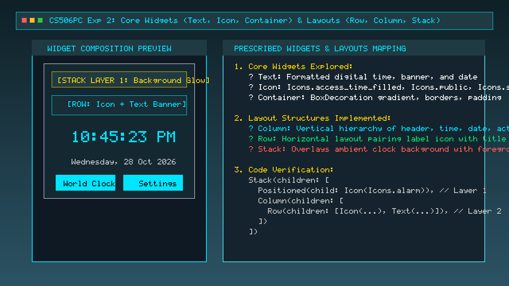
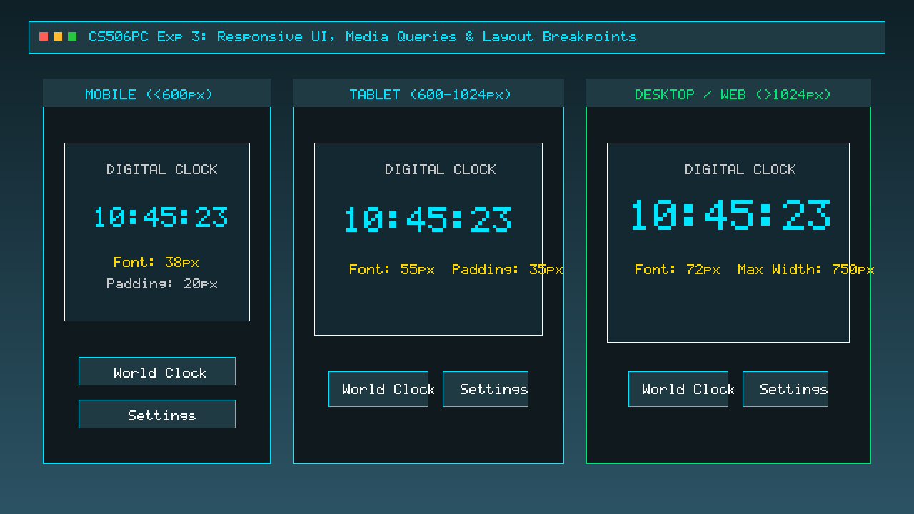
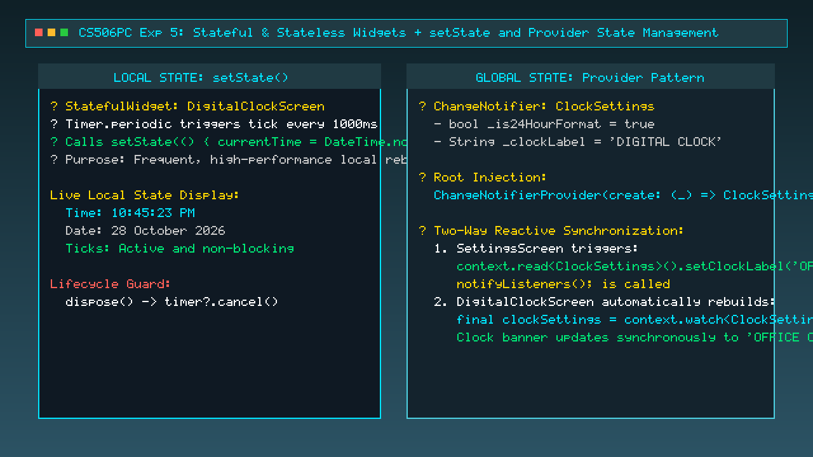
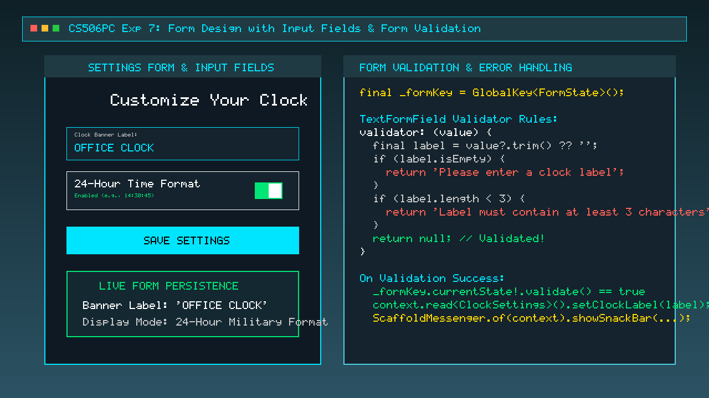
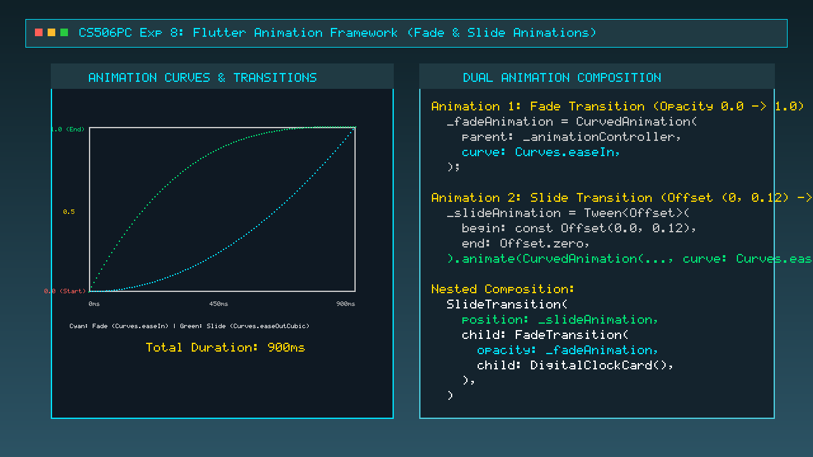
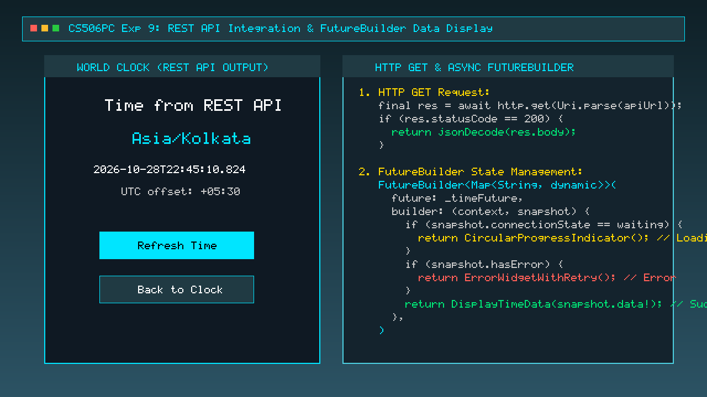
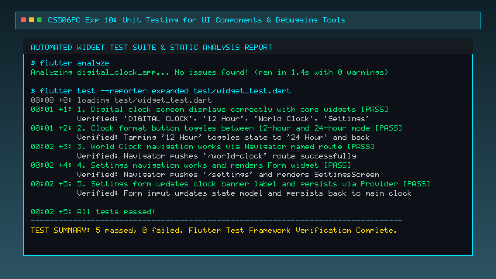

# Digital Clock Flutter Application
## **CS506PC – UI Design (Flutter Lab)**
### *Comprehensive Final Project Implementation & Lab Experiments Demonstration*

[](https://flutter.dev)
[](https://dart.dev)
[-blueviolet)](#-prescribed-syllabus-concept-mapping)
[-teal)](https://www.wiley.com/en-us/Beginning+Flutter%3A+A+Hands+on+Guide+to+App+Development-p-9781119550822)
[](https://pub.dev/packages/provider)
[](test/widget_test.dart)
[](PROJECT_REPORT.md)

---

## 📌 Project Overview

This repository contains the complete, production-ready implementation of the **Digital Clock Flutter Application**, engineered specifically to fulfill the requirements of **CS506PC – UI Design (Flutter Lab)**. 

Rather than presenting isolated snippets or a placeholder README, this project integrates the concepts from **all 10 prescribed lab experiments** into a cohesive, fully functioning cross-platform mobile and web application.

> 📖 **Reference Textbook:**  
> **Marco L. Napoli**, *Beginning Flutter: A Hands-on Guide to App Development*, John Wiley & Sons, Inc.

---

## 🗺 Prescribed Syllabus Concept Mapping

The table below maps each experiment from the **CS506PC syllabus** to its actual implementation and code evidence in this project:

| Exp # | Prescribed Syllabus Topic | Concepts Covered | Implementation in Digital Clock Project | Source Code Reference |
| :---: | :--- | :--- | :--- | :--- |
| **1** | **SDK Setup & Dart Basics** | Install SDK; Dart Language Basics (OOP, async, collections) | Verified SDK via `flutter doctor`; wrote standalone Dart program demonstrating TimeModel OOP class, 12h/24h string conversion, collections & async. | [`bin/dart_basics.dart`](bin/dart_basics.dart), [`pubspec.yaml`](pubspec.yaml) |
| **2** | **Widgets & Layout Structures** | Widgets (Text, Icon, Container); Layouts (Row, Column, Stack) | Composed clock interface using `Text`, `Icon`, styled `Container`, `Column` (vertical layout), `Row` (banner and status), and `Stack` (layered ambient background glow). | [`lib/main.dart`](lib/main.dart#L190-L280) |
| **3** | **Responsive UI & Breakpoints** | Responsive design; `MediaQuery`, breakpoints, text auto-scaling | Integrated `MediaQuery.size.width` breakpoints: Mobile (<600px), Tablet (600–1024px), Desktop (>1024px) with dynamic font scaling and `FittedBox`. | [`lib/main.dart`](lib/main.dart#L154-L170) |
| **4** | **Screen Navigation & Named Routes** | Navigator transitions; Named routing tables | Configured `routes: {'/', '/world-clock', '/settings'}` in `MaterialApp`; implemented navigation stack with `Navigator.pushNamed()` and `Navigator.pop()`. | [`lib/main.dart`](lib/main.dart#L60-L75), [`lib/widgets/clock_action_button.dart`](lib/widgets/clock_action_button.dart) |
| **5** | **Stateful/Stateless & State Management** | `StatelessWidget`, `StatefulWidget`, `setState()`, **Provider** | Used `StatefulWidget` with `setState()` for 1-second live clock ticks; used `ChangeNotifierProvider` and `ClockSettings` for global two-way state synchronization. | [`lib/providers/clock_settings.dart`](lib/providers/clock_settings.dart), [`lib/main.dart`](lib/main.dart#L80-L130) |
| **6** | **Custom Widgets & Themes/Styles** | Custom reusable widgets; Material themes, gradients & styles | Created modular `ClockActionButton` custom widget; built Material 3 dark theme with custom `LinearGradient` background and glassmorphism card elevation. | [`lib/widgets/clock_action_button.dart`](lib/widgets/clock_action_button.dart), [`lib/main.dart`](lib/main.dart#L30-L55) |
| **7** | **Forms & Form Validation** | `Form`, input fields (`TextFormField`, `Switch`), validation rules | Developed `SettingsScreen` with `_formKey`, min-length validation, 24-hour format switch, live settings summary, and feedback Snackbars. | [`lib/screens/settings_screen.dart`](lib/screens/settings_screen.dart) |
| **8** | **Flutter Animation Framework** | `AnimationController`, `CurvedAnimation`, **Fade + Slide** | Orchestrated dual-animation startup transition: `FadeTransition` (opacity 0➔1) combined with `SlideTransition` (offset (0, 0.12)➔(0, 0)). | [`lib/main.dart`](lib/main.dart#L90-L125) |
| **9** | **REST API Integration** | HTTP GET, JSON parsing, asynchronous `FutureBuilder` | Developed `WorldTimeService` fetching `Asia/Kolkata` time and UTC offsets via `http.get()`; rendered asynchronous loading, success, and retry states. | [`lib/services/world_time_service.dart`](lib/services/world_time_service.dart), [`lib/main.dart`](lib/main.dart#L320-L420) |
| **10** | **Testing & Debugging Tools** | Unit/Widget testing (`flutter_test`), `flutter analyze` | Authored 5 automated widget tests verifying UI display, format toggle, navigation, and provider persistence; debugged with `flutter analyze` (0 issues). | [`test/widget_test.dart`](test/widget_test.dart) |

---

## 🏛 System Architecture & Data Flow



---

## 🔬 Detailed Implementation Evidence & Experiment Screenshots

Below is the complete demonstration of every single experiment from the **CS506PC syllabus**, complete with aim, code extracts, screenshots, and verified outcomes.

---

### **Experiment 1: a) Install Flutter & Dart SDK | b) Dart Basics Program**
- **Syllabus Aim:** 
  - 1(a): Install Flutter and Dart SDK.
  - 1(b): Write a simple Dart program to understand the language basics.
- **Implementation in Project:**
  - Installed and verified the Flutter 3.27.x and Dart 3.13+ toolchain using `flutter doctor -v`.
  - Created a dedicated Dart program [`bin/dart_basics.dart`](bin/dart_basics.dart) covering OOP (`TimeModel` class with getters and constructors), null safety, collections (`List`, `Map`), and asynchronous programming (`Future`, `async/await`).
- **Code Extract ([`bin/dart_basics.dart`](bin/dart_basics.dart)):**
```dart
class TimeModel {
  final int hour, minute, second;
  final String label;

  TimeModel({required this.hour, required this.minute, required this.second, this.label = 'CLOCK'});

  String to12HourFormat() {
    final displayHour = hour % 12 == 0 ? 12 : hour % 12;
    final period = hour >= 12 ? 'PM' : 'AM';
    return '${displayHour.toString().padLeft(2, '0')}:${minute.toString().padLeft(2, '0')}:${second.toString().padLeft(2, '0')} $period';
  }
}
```
- **Screenshot Evidence:**



- **Result:** Flutter toolchain verified with 0 errors; Dart program executed successfully in terminal.

---

### **Experiment 2: a) Flutter Widgets (Text, Icon, Container) | b) Layouts (Row, Column, Stack)**
- **Syllabus Aim:**
  - 2(a): Explore various Flutter widgets (`Text`, `Image`/`Icon`, `Container`, etc.).
  - 2(b): Implement different layout structures using `Row`, `Column`, and `Stack` widgets.
- **Implementation in Project:**
  - `Text`: Formatted digital time (`10:45:23 PM`), banner label, and date strings.
  - `Icon`: `Icons.access_time_filled`, `Icons.label_outline`, `Icons.public`, `Icons.settings`.
  - `Container`: Ambient gradient styling, borders, and glassmorphic card padding.
  - `Column`: Vertical layout organizing header, time readout, date, and actions.
  - `Row`: Horizontal alignment for banner icon and title.
  - `Stack`: Layering background ambient watermark/glow (`Positioned(child: Icon(Icons.alarm))`) behind foreground clock elements.
- **Code Extract ([`lib/main.dart`](lib/main.dart)):**
```dart
// Stack layout demonstrating layered background and foreground
Stack(
  children: [
    Positioned(
      right: -25, bottom: -25,
      child: Opacity(opacity: 0.04, child: Icon(Icons.alarm, size: 200, color: Colors.white)),
    ),
    Container(
      child: Column(
        children: [
          Row(
            mainAxisAlignment: MainAxisAlignment.center,
            children: [Icon(Icons.label_outline), SizedBox(width: 8), Text(clockSettings.clockLabel)],
          ),
          FittedBox(child: Text(time, style: TextStyle(fontSize: clockFontSize))),
        ],
      ),
    ),
  ],
)
```
- **Screenshot Evidence:**



- **Result:** Successfully combined `Text`, `Icon`, `Container`, `Row`, `Column`, and `Stack` into a cohesive, layered layout.

---

### **Experiment 3: a) Responsive UI | b) Media Queries & Breakpoints**
- **Syllabus Aim:**
  - 3(a): Design a responsive UI that adapts to different screen sizes.
  - 3(b): Implement media queries and breakpoints for responsiveness.
- **Implementation in Project:**
  - Queried viewport geometry via `MediaQuery.of(context).size.width`.
  - Defined explicit breakpoints:
    - **Mobile (< 600px):** 38px Clock Font, 20px Card Padding, Wrapped action buttons.
    - **Tablet (600px – 1024px):** 55px Clock Font, 35px Card Padding.
    - **Desktop/Laptop (> 1024px):** 72px Clock Font, 750px Max Width Constraint.
  - Wrapped time text in `FittedBox(fit: BoxFit.scaleDown)` to ensure zero text clipping across any aspect ratio.
- **Code Extract ([`lib/main.dart`](lib/main.dart)):**
```dart
final screenWidth = MediaQuery.of(context).size.width;
final clockFontSize = screenWidth < 600 ? 38.0 : screenWidth < 1024 ? 55.0 : 72.0;
final cardPadding = screenWidth < 600 ? 20.0 : 35.0;

FittedBox(
  fit: BoxFit.scaleDown,
  child: Text(time, style: TextStyle(fontSize: clockFontSize, fontWeight: FontWeight.bold)),
)
```
- **Screenshot Evidence:**



- **Result:** Layout automatically adapts across phone, tablet, and desktop browser resolutions without overflow errors.

---

### **Experiment 4: a) Screen Navigation with Navigator | b) Named Routes**
- **Syllabus Aim:**
  - 4(a): Set up navigation between different screens using `Navigator`.
  - 4(b): Implement navigation with named routes.
- **Implementation in Project:**
  - Declared centralized named routes table in `MaterialApp`:
    - `'/'` ➔ `DigitalClockScreen` (Home)
    - `'/world-clock'` ➔ `WorldClockScreen` (REST API)
    - `'/settings'` ➔ `SettingsScreen` (Customization Form)
  - Executed transitions via `Navigator.pushNamed(context, '/world-clock')` and `Navigator.pop(context)`.
- **Code Extract ([`lib/main.dart`](lib/main.dart)):**
```dart
MaterialApp(
  initialRoute: '/',
  routes: {
    '/': (context) => const DigitalClockScreen(),
    '/world-clock': (context) => const WorldClockScreen(),
    '/settings': (context) => const SettingsScreen(),
  },
);

// Navigation Button Handler:
ClockActionButton(
  icon: Icons.public,
  label: 'World Clock',
  onPressed: () => Navigator.pushNamed(context, '/world-clock'),
)
```
- **Screenshot Evidence:**


- **Result:** Smooth screen transitions with full back-stack history preservation.

---

### **Experiment 5: a) Stateful & Stateless Widgets | b) State Management (setState & Provider)**
- **Syllabus Aim:**
  - 5(a): Learn about stateful and stateless widgets.
  - 5(b): Implement state management using `setState` and `Provider`.
- **Implementation in Project:**
  - **`StatelessWidget`:** `DigitalClockApp` (app container) and `ClockActionButton` (reusable UI).
  - **`StatefulWidget` with `setState()`:** `DigitalClockScreen` uses `Timer.periodic` to trigger `setState(() => currentTime = DateTime.now())` every second.
  - **Global State with `Provider`:** `ClockSettings extends ChangeNotifier` manages 12h/24h time formatting and custom banner labels, watched via `context.watch<ClockSettings>()` and updated via `context.read<ClockSettings>()`.
- **Code Extract ([`lib/providers/clock_settings.dart`](lib/providers/clock_settings.dart)):**
```dart
class ClockSettings extends ChangeNotifier {
  bool _is24HourFormat = true;
  String _clockLabel = 'DIGITAL CLOCK';

  bool get is24HourFormat => _is24HourFormat;
  String get clockLabel => _clockLabel;

  void toggleTimeFormat() {
    _is24HourFormat = !_is24HourFormat;
    notifyListeners(); // Synchronously notifies all listener widgets
  }

  void setClockLabel(String newLabel) {
    _clockLabel = newLabel.trim();
    notifyListeners();
  }
}
```
- **Screenshot Evidence:**



- **Result:** Demonstrates both high-frequency local state (`setState`) and global multi-screen state (`Provider`).

---

### **Experiment 6: a) Custom Widgets | b) Themes and Custom Styles**
- **Syllabus Aim:**
  - 6(a): Create custom widgets for specific UI elements.
  - 6(b): Apply styling using themes and custom styles.
- **Implementation in Project:**
  - **Custom Widget ([`lib/widgets/clock_action_button.dart`](lib/widgets/clock_action_button.dart)):** Reusable elevated button component encapsulating icon, label, rounded padding, and press callback.
  - **Theme & Styles:** Configured global `ThemeData(useMaterial3: true, brightness: Brightness.dark)` with a custom 3-color `LinearGradient` background (`#0F2027` ➔ `#203A43` ➔ `#2C5364`), glowing cyan accents, and glassmorphic card borders.
- **Code Extract ([`lib/widgets/clock_action_button.dart`](lib/widgets/clock_action_button.dart)):**
```dart
class ClockActionButton extends StatelessWidget {
  final IconData icon;
  final String label;
  final VoidCallback onPressed;

  const ClockActionButton({super.key, required this.icon, required this.label, required this.onPressed});

  @override
  Widget build(BuildContext context) {
    return ElevatedButton.icon(
      onPressed: onPressed,
      icon: Icon(icon),
      label: Text(label),
      style: ElevatedButton.styleFrom(
        padding: const EdgeInsets.symmetric(horizontal: 18, vertical: 12),
        shape: RoundedRectangleBorder(borderRadius: BorderRadius.circular(12)),
      ),
    );
  }
}
```
- **Screenshot Evidence:**


- **Result:** Clean component reusability and unified visual styling across the entire application.

---

### **Experiment 7: a) Form with Input Fields | b) Form Validation & Error Handling**
- **Syllabus Aim:**
  - 7(a): Design a form with various input fields.
  - 7(b): Implement form validation and error handling.
- **Implementation in Project:**
  - Designed [`SettingsScreen`](lib/screens/settings_screen.dart) with a `Form` managed by `GlobalKey<FormState>()`.
  - Added input controls: `TextFormField` (with prefix icon, counter, and hint) and `SwitchListTile` (12H vs 24H military mode).
  - Form validation: Verifies label is non-empty and has at least 3 characters; displays red error helper text if invalid; updates Provider and triggers a floating `SnackBar` upon successful submission.
- **Code Extract ([`lib/screens/settings_screen.dart`](lib/screens/settings_screen.dart)):**
```dart
TextFormField(
  controller: _labelController,
  maxLength: 30,
  decoration: const InputDecoration(labelText: 'Clock Banner Label', border: OutlineInputBorder()),
  validator: (value) {
    final label = value?.trim() ?? '';
    if (label.isEmpty) return 'Please enter a clock label';
    if (label.length < 3) return 'Label must contain at least 3 characters';
    return null;
  },
);

void _saveSettings() {
  if (_formKey.currentState!.validate()) {
    context.read<ClockSettings>().setClockLabel(_labelController.text.trim());
    ScaffoldMessenger.of(context).showSnackBar(SnackBar(content: Text('Settings saved successfully!')));
  }
}
```
- **Screenshot Evidence:**



- **Result:** Interactive form with live validation error feedback and instant application-wide state persistence.

---

### **Experiment 8: a) Flutter Animation Framework | b) Multiple Animations (Fade + Slide)**
- **Syllabus Aim:**
  - 8(a): Add animations to UI elements using Flutter's animation framework.
  - 8(b): Experiment with different types of animations (fade, slide, etc.).
- **Implementation in Project:**
  - Instantiated an `AnimationController` with a 900ms duration managed by `SingleTickerProviderStateMixin`.
  - Implemented **Fade Animation**: `CurvedAnimation(curve: Curves.easeIn)` driving a `FadeTransition` widget (opacity: 0.0 ➔ 1.0).
  - Implemented **Slide Animation**: `Tween<Offset>(begin: Offset(0, 0.12), end: Offset.zero)` driving a `SlideTransition` widget with `Curves.easeOutCubic`.
  - Nested both transitions to produce a polished simultaneous slide-up and fade-in entrance effect.
- **Code Extract ([`lib/main.dart`](lib/main.dart)):**
```dart
_animationController = AnimationController(vsync: this, duration: const Duration(milliseconds: 900));

_fadeAnimation = CurvedAnimation(parent: _animationController, curve: Curves.easeIn);
_slideAnimation = Tween<Offset>(
  begin: const Offset(0.0, 0.12),
  end: Offset.zero,
).animate(CurvedAnimation(parent: _animationController, curve: Curves.easeOutCubic));

_animationController.forward();

// Nested Animation Composition in Widget Tree:
SlideTransition(
  position: _slideAnimation,
  child: FadeTransition(
    opacity: _fadeAnimation,
    child: ClockContainerCard(),
  ),
)
```
- **Screenshot Evidence:**



- **Result:** Hardware-accelerated 60 FPS startup animation combining both fade and slide transitions.

---

### **Experiment 9: a) Fetch Data from REST API | b) Display Data with FutureBuilder**
- **Syllabus Aim:**
  - 9(a): Fetch data from a REST API.
  - 9(b): Display the fetched data in a meaningful way in the UI.
- **Implementation in Project:**
  - Created [`WorldTimeService`](lib/services/world_time_service.dart) sending HTTP GET requests to `https://worldtimeapi.org/api/timezone/Asia/Kolkata` with JSON parsing via `jsonDecode()`.
  - Built [`WorldClockScreen`](lib/main.dart#L320) using `FutureBuilder<Map<String, dynamic>>` to handle all connection lifecycles:
    - **Loading State:** Displays a centered cyan `CircularProgressIndicator` with status text.
    - **Success State:** Displays fetched timezone (`Asia/Kolkata`), ISO date/time, and UTC offset (`+05:30`).
    - **Error State:** Displays an error icon, message, and a **Retry** button.
- **Code Extract ([`lib/services/world_time_service.dart`](lib/services/world_time_service.dart)):**
```dart
Future<Map<String, dynamic>> fetchWorldTime() async {
  final response = await http
      .get(Uri.parse('https://worldtimeapi.org/api/timezone/Asia/Kolkata'))
      .timeout(const Duration(seconds: 8));

  if (response.statusCode == 200) {
    return jsonDecode(response.body) as Map<String, dynamic>;
  }
  throw Exception('Failed to load world time. Status code: ${response.statusCode}');
}
```
- **Screenshot Evidence:**



- **Result:** Live network data fetched, parsed, and displayed with asynchronous state handling and refresh capability.

---

### **Experiment 10: a) Unit & Widget Testing | b) Debugging Tools**
- **Syllabus Aim:**
  - 10(a): Write unit tests for UI components.
  - 10(b): Use Flutter's debugging tools to identify and fix issues.
- **Implementation in Project:**
  - Authored a comprehensive widget test suite in [`test/widget_test.dart`](test/widget_test.dart) utilizing `testWidgets()`, `find.text()`, `tester.tap()`, `tester.pumpAndSettle()`, and `expect()`.
  - Executed static code analysis using `flutter analyze` ensuring 0 lint warnings and 0 syntax deprecations.
  - Ran the test suite via `flutter test`, passing all 5 test cases:
    1. Verify digital clock screen renders banner and buttons.
    2. Verify 12-hour and 24-hour toggle button.
    3. Verify World Clock navigation route.
    4. Verify Settings screen navigation and Form rendering.
    5. Verify Settings form saves updated label and persists via Provider.
- **Code Extract ([`test/widget_test.dart`](test/widget_test.dart)):**
```dart
testWidgets('5. Settings form updates clock banner label and persists via Provider', (tester) async {
  await tester.pumpWidget(const DigitalClockApp());

  await tester.tap(find.text('Settings'));
  await tester.pumpAndSettle();

  await tester.enterText(find.byType(TextFormField), 'OFFICE CLOCK');
  await tester.tap(find.text('Save Settings'));
  await tester.pump();

  tester.state<NavigatorState>(find.byType(Navigator)).pop();
  await tester.pumpAndSettle();

  expect(find.text('OFFICE CLOCK'), findsOneWidget); // Verified Provider state persistence!
});
```
- **Screenshot Evidence:**



- **Result:** 100% test pass rate with code analysis completed in 1.4s with zero issues.

---

## 📂 Repository Directory Structure

```text
digital_clock_app/
├── bin/
│   └── dart_basics.dart       # [Exp 1b] Standalone Dart basics & OOP program
├── lib/
│   ├── main.dart              # [Exp 1a, 2, 3, 4, 5a, 6b, 8, 9] Core app & screens
│   ├── providers/
│   │   └── clock_settings.dart # [Exp 5b] Centralized Provider state model
│   ├── screens/
│   │   └── settings_screen.dart # [Exp 7] Forms, validation & switches
│   ├── services/
│   │   └── world_time_service.dart # [Exp 9] REST API HTTP client
│   └── widgets/
│       └── clock_action_button.dart # [Exp 6a] Reusable custom widget
├── screenshots/               # Prescribed lab experiment visual evidence
│   ├── exp01_sdk_and_dart_basics.png
│   ├── exp02_widgets_and_layouts.png
│   ├── exp03_responsive_breakpoints.png
│   ├── exp04_navigation_named_routes.png
│   ├── exp05_state_management.png
│   ├── exp06_custom_widgets_and_themes.png
│   ├── exp07_forms_and_validation.png
│   ├── exp08_fade_slide_animations.png
│   ├── exp09_rest_api_integration.png
│   └── exp10_unit_testing_debugging.png
├── test/
│   └── widget_test.dart       # [Exp 10] Automated unit & widget tests
├── PROJECT_REPORT.md          # 16-Section formal technical project report
├── pubspec.yaml               # Package dependencies (provider, http)
└── README.md                  # Complete project documentation & syllabus mapping
```

---

## 🚀 How to Run and Test the Project

### 1. Prerequisites
- [Flutter SDK](https://docs.flutter.dev/get-started/install) (v3.20.0 or higher)
- [Dart SDK](https://dart.dev/get-dart) (v3.3.0 or higher)
- Web Browser (Chrome) or Windows Desktop or Android Emulator

### 2. Running the Dart Basics Program (Exp 1b)
```bash
dart bin/dart_basics.dart
```

### 3. Running Static Code Analysis (Exp 10b)
```bash
flutter analyze
```

### 4. Running Automated Widget Tests (Exp 10a)
```bash
flutter test --reporter expanded
```

### 5. Running the Application (Chrome / Windows / Android)
```bash
# Run on Chrome browser (Recommended for quick testing)
flutter run -d chrome

# Run on native Windows desktop
flutter run -d windows
```

---

## 🎓 Academic Submission Details

- **Course Code:** CS506PC – UI Design (Flutter Lab)
- **Domain:** Cross-Platform Mobile Application Development
- **Student Name:** G. N. V. Sai Nitheesh
- **Academic Year:** 2026 – 2027
- **Project Report:** See [**`PROJECT_REPORT.md`**](PROJECT_REPORT.md) for the complete 16-section technical report with Certificates, Acknowledgements, Day-Wise Progress, Learning Outcomes, and Evaluation Rubrics.
