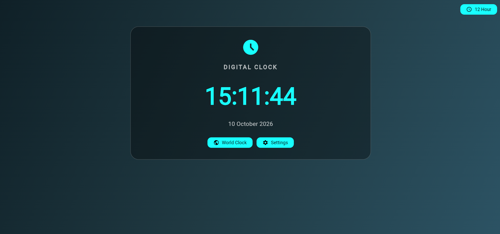
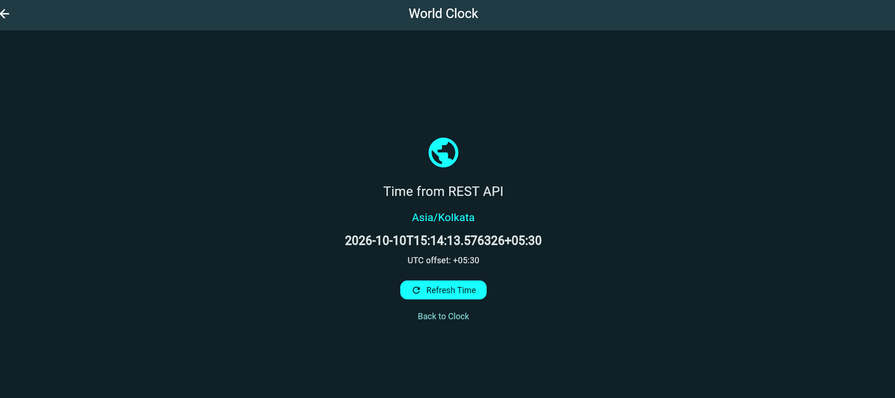

## Experiment 9: REST API Integration

**Aim:** To fetch data from a REST API and display it in a Flutter application.

**Implementation:**
- Used the `http` package to send GET requests.
- Used `async` and `await` for asynchronous operations.
- Parsed JSON responses using `jsonDecode()`.
- Used `FutureBuilder` to manage loading, success, and error states.
- Implemented Retry and Refresh Time buttons.

**Output:**

**Result:** The application successfully fetched and displayed the Asia/Kolkata timezone, date/time, and UTC offset from a REST API.
