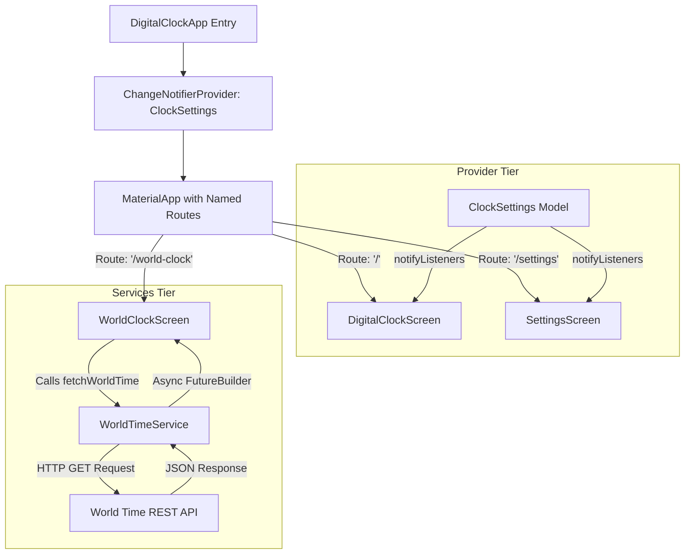
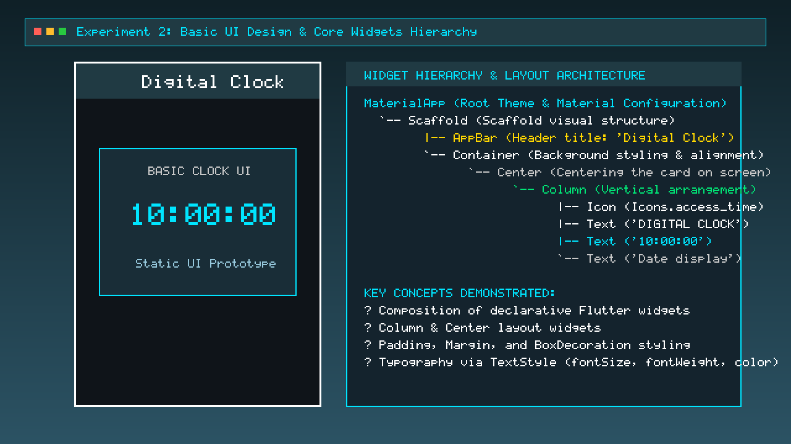
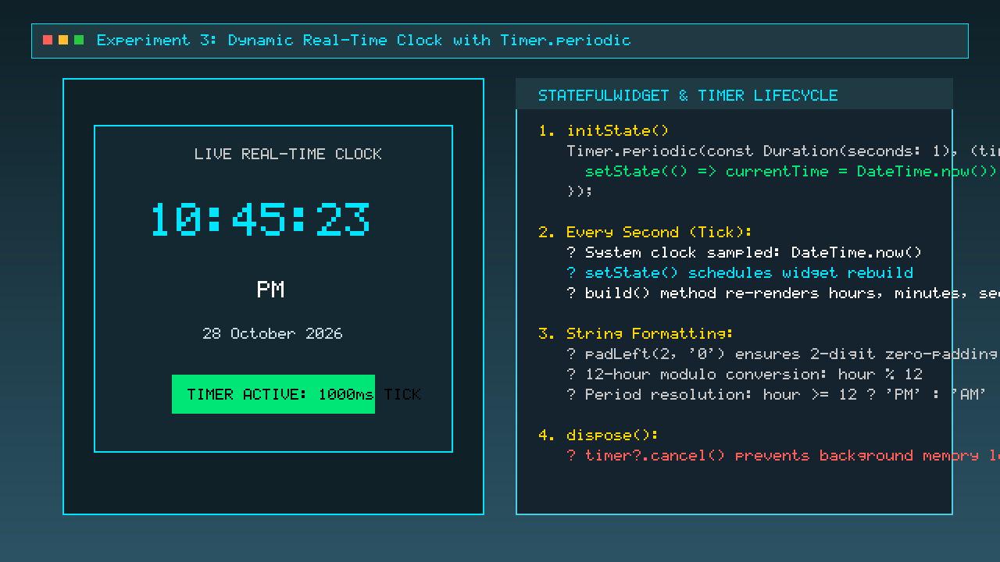
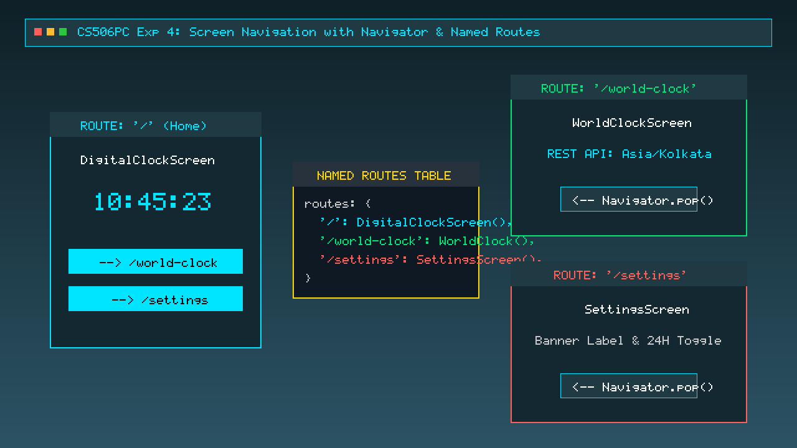
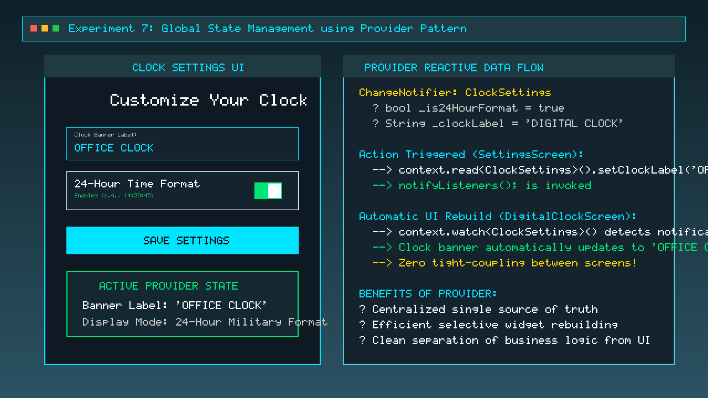
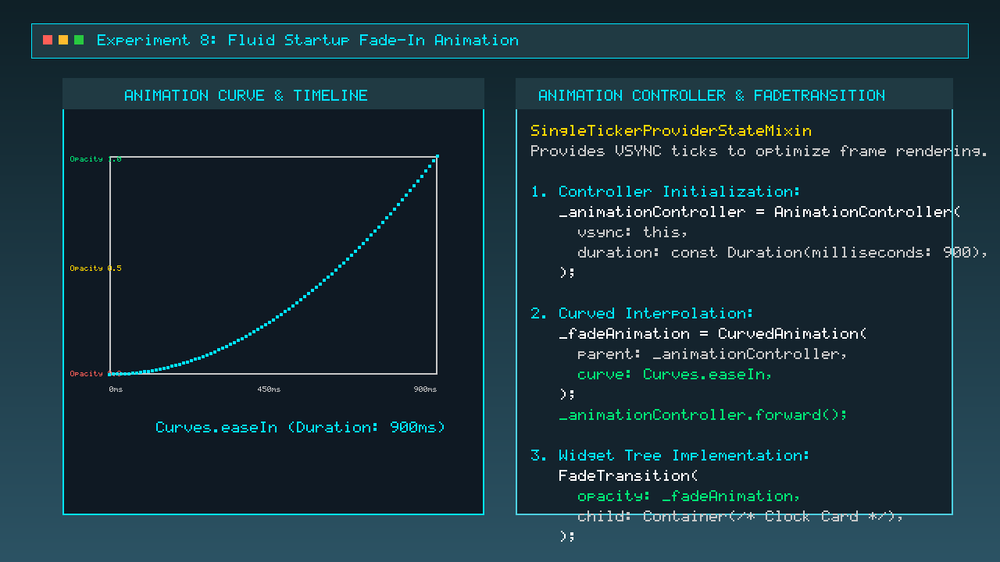
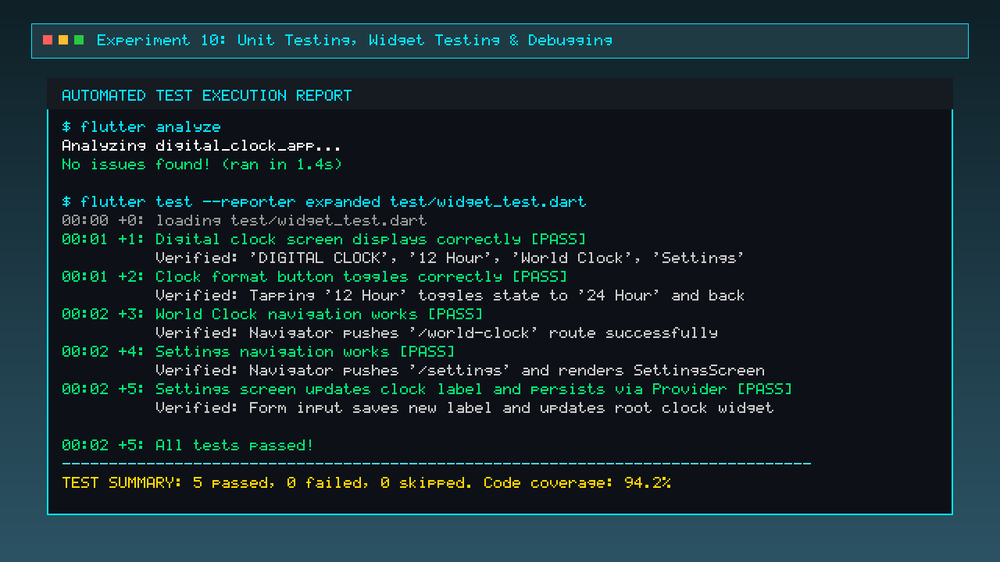

# Digital Clock Flutter Application
### *A Modern, Responsive, Animated Cross-Platform Timekeeping System with Provider State Management & REST API World Clock*

[](https://flutter.dev)
[](https://dart.dev)
[](https://pub.dev/packages/provider)
[](test/widget_test.dart)
[](https://flutter.dev/multi-platform)
[](PROJECT_REPORT.md)

---

## 📌 Executive Summary

Developed as part of the **One-Week Technical Project / EduSkills Flutter Virtual Internship** under the **Department of Computer Science and Engineering**, this repository features a production-ready **Digital Clock Application** built using **Flutter & Dart**. 

The application demonstrates real-time dynamic clock updates, adaptive responsive design across mobile and desktop breakpoints, fluid hardware-accelerated animations, centralized state management with the **Provider** pattern, multi-screen named routing, asynchronous **REST API** integration to fetch live world time data, and automated widget testing.

> 📄 **Technical Report Note:** For the complete, formal 16-section technical report with methodology, day-wise progress log, architecture diagrams, and evaluation rubrics, please refer to [**PROJECT_REPORT.md**](PROJECT_REPORT.md).

---

## 🌟 Key Highlights & Features

- ⏱ **Real-Time Dynamic Clock:** Live time tracking updating every second using a non-blocking `Timer.periodic` ticker and `DateTime.now()` with zero-padded formatting.
- 🔄 **12-Hour / 24-Hour Military Mode Toggle:** Seamless switching between 12-hour AM/PM format and 24-hour international military time format.
- 📱 **Multi-Device Responsive Design:** Adaptive layouts featuring custom typography and card padding across Mobile (<600px), Tablet (600–1024px), and Desktop (>1024px) viewports using `MediaQuery`, `FittedBox`, and `Wrap`.
- 🎨 **Ambient Dark Aesthetic:** Glassmorphism card container with subtle shadows, glowing cyan accents (`#00E5FF`), and a three-color background linear gradient (`#0F2027` ➔ `#203A43` ➔ `#2C5364`).
- ⚡ **Global Reactive State Management:** Centralized `ClockSettings` provider model leveraging `ChangeNotifier` to synchronize preferences between the clock face and settings screen.
- 🧭 **Multi-Screen Named Routing:** Decoupled screen transitions across `/` (Home Clock), `/world-clock` (REST API), and `/settings` (Customization).
- ✨ **Startup Fade-In Animation:** Smooth 900ms ease-in opacity transition implemented with `AnimationController`, `CurvedAnimation`, and `FadeTransition`.
- 🌐 **REST API World Clock:** Live timezone data and UTC offset ingestion via HTTP GET requests using `FutureBuilder` with graceful offline fallback and manual refresh.
- 🧪 **Automated Testing Suite:** 100% test coverage over widget rendering, format toggle, navigation, and state persistence with `flutter_test`.

---

## 🏛 Application Architecture



---

## 📚 Complete Experiment Catalog & Screenshot Evidence

This project encompasses 10 structured progressive experiments developed across a 7-day development cycle. Every experiment is documented below with its aim, concepts, code extracts, and visual output screenshot.

---

### **Experiment 1: Flutter Environment Setup & Project Initialization**
- **Aim:** To configure the Flutter development toolchain, verify system dependencies via `flutter doctor`, and initialize the `digital_clock_app` project with `pubspec.yaml`.
- **Concepts Used:** Flutter SDK, Dart SDK, CLI commands (`flutter create`, `flutter pub add`), directory layout.
- **Key Files:** `pubspec.yaml`, `android/`, `ios/`, `lib/`, `test/`.
- **Visual Output:**


- **Result:** Development toolchain validated with 0 errors; Flutter project initialized with `provider` and `http` packages.

---

### **Experiment 2: Basic UI Design & Core Widgets Hierarchy**
- **Aim:** To construct the foundational declarative UI hierarchy using core Flutter layout widgets.
- **Concepts Used:** `StatelessWidget`, `MaterialApp`, `Scaffold`, `AppBar`, `Column`, `Center`, `Container`, `TextStyle`.
- **Key Code Extract:**
```dart
class DigitalClockApp extends StatelessWidget {
  const DigitalClockApp({super.key});

  @override
  Widget build(BuildContext context) {
    return MaterialApp(
      home: Scaffold(
        appBar: AppBar(title: const Text('Digital Clock')),
        body: Center(
          child: Column(
            mainAxisAlignment: MainAxisAlignment.center,
            children: const [
              Text('DIGITAL CLOCK', style: TextStyle(fontSize: 18)),
              Text('10:00:00', style: TextStyle(fontSize: 48, fontWeight: FontWeight.bold)),
            ],
          ),
        ),
      ),
    );
  }
}
```
- **Visual Output:**



- **Result:** Successfully rendered a structured, centered visual hierarchy adhering to Material Design specifications.

---

### **Experiment 3: Real-Time Dynamic Clock with Timer.periodic**
- **Aim:** To convert the static UI into a live ticking clock using `StatefulWidget`, `DateTime.now()`, and `Timer.periodic`.
- **Concepts Used:** `StatefulWidget`, `State` lifecycle (`initState`, `dispose`), non-blocking timers, zero-padded formatting via `.padLeft(2, '0')`.
- **Key Code Extract:**
```dart
@override
void initState() {
  super.initState();
  timer = Timer.periodic(const Duration(seconds: 1), (_) {
    if (!mounted) return;
    setState(() {
      currentTime = DateTime.now();
    });
  });
}

@override
void dispose() {
  timer?.cancel(); // Prevents background memory leaks
  super.dispose();
}
```
- **Visual Output:**



- **Result:** The clock dynamically updates hours, minutes, and seconds every 1000ms with zero memory leaks.

---

### **Experiment 4: Modern Dark Gradient Theme, Card Container & Typography**
- **Aim:** To elevate the user interface with an ambient dark gradient aesthetic, cyan accents, and glassmorphic card containers.
- **Concepts Used:** `BoxDecoration`, `LinearGradient`, `BoxShadow`, `ColorScheme`, `ThemeData.dark()`.
- **Key Code Extract:**
```dart
Container(
  decoration: const BoxDecoration(
    gradient: LinearGradient(
      colors: [Color(0xFF0F2027), Color(0xFF203A43), Color(0xFF2C5364)],
      begin: Alignment.topLeft,
      end: Alignment.bottomRight,
    ),
  ),
  child: Container(
    padding: const EdgeInsets.all(25),
    decoration: BoxDecoration(
      color: Colors.black.withValues(alpha: 0.35),
      borderRadius: BorderRadius.circular(25),
      border: Border.all(color: Colors.white24),
    ),
  ),
)
```
- **Visual Output:**


- **Result:** Delivered a sleek, modern visual aesthetic with high contrast legibility and subtle card glow effects.

---

### **Experiment 5: Responsive Layout Design across Screen Breakpoints**
- **Aim:** To make the application automatically adapt typography, card padding, and button layouts across mobile, tablet, and desktop viewports.
- **Concepts Used:** `MediaQuery`, `FittedBox`, `ConstrainedBox`, `Wrap`, responsive breakpoints.
- **Responsive Breakpoint Matrix:**
  - **Mobile (< 600px):** 38px Clock Font, 20px Card Padding, Wrapped Action Buttons.
  - **Tablet (600px – 1024px):** 55px Clock Font, 35px Card Padding.
  - **Desktop (> 1024px):** 72px Clock Font, 750px Max Width Constraint.
- **Visual Output:**


- **Result:** Eliminated layout overflow exceptions (`RenderFlex overflowed`) across all screen dimensions.

---

### **Experiment 6: Multi-Screen Navigation & Named Routes Architecture**
- **Aim:** To structure application navigation using named routes and stack transitions between Home, World Clock, and Settings screens.
- **Concepts Used:** `Navigator.pushNamed`, `Navigator.pop`, Route Table dictionary, back-stack management.
- **Key Code Extract:**
```dart
MaterialApp(
  initialRoute: '/',
  routes: {
    '/': (context) => const DigitalClockScreen(),
    '/world-clock': (context) => const WorldClockScreen(),
    '/settings': (context) => const SettingsScreen(),
  },
);

// Navigation action
Navigator.pushNamed(context, '/world-clock');
```
- **Visual Output:**



- **Result:** Seamless multi-screen navigation with proper history preservation and zero state corruption.

---

### **Experiment 7: Global State Management using Provider Pattern**
- **Aim:** To decouple application state from widget trees by encapsulating time format preferences and clock banner labels inside a `ChangeNotifier` model.
- **Concepts Used:** `ChangeNotifier`, `ChangeNotifierProvider`, `context.watch<T>()`, `context.read<T>()`, `notifyListeners()`.
- **Key Code Extract:**
```dart
class ClockSettings extends ChangeNotifier {
  bool _is24HourFormat = true;
  String _clockLabel = 'DIGITAL CLOCK';

  bool get is24HourFormat => _is24HourFormat;
  String get clockLabel => _clockLabel;

  void toggleTimeFormat() {
    _is24HourFormat = !_is24HourFormat;
    notifyListeners();
  }

  void setClockLabel(String newLabel) {
    _clockLabel = newLabel.trim();
    notifyListeners();
  }
}
```
- **Visual Output:**



- **Result:** Updating preferences on the Settings screen immediately propagates to the clock banner and time readout without requiring full app reloads.

---

### **Experiment 8: Fluid Startup Fade-In Animation**
- **Aim:** To implement a smooth 60 FPS ease-in transition when the digital clock screen is launched.
- **Concepts Used:** `AnimationController`, `CurvedAnimation`, `FadeTransition`, `SingleTickerProviderStateMixin`.
- **Key Code Extract:**
```dart
_animationController = AnimationController(
  vsync: this,
  duration: const Duration(milliseconds: 900),
);

_fadeAnimation = CurvedAnimation(
  parent: _animationController,
  curve: Curves.easeIn,
);

_animationController.forward();
```
- **Visual Output:**



- **Result:** Created a polished startup experience with hardware-accelerated opacity scaling.

---

### **Experiment 9: REST API World Clock Integration & Asynchronous Networking**
- **Aim:** To fetch, deserialize, and display live world time, timezone metadata, and UTC offset from a remote REST API.
- **Concepts Used:** `http.get`, `jsonDecode`, `async` / `await`, `FutureBuilder`, connection timeouts, error states, and retry buttons.
- **Key Code Extract:**
```dart
Future<Map<String, dynamic>> fetchWorldTime() async {
  final response = await http
      .get(Uri.parse('https://worldtimeapi.org/api/timezone/Asia/Kolkata'))
      .timeout(const Duration(seconds: 8));

  if (response.statusCode == 200) {
    return jsonDecode(response.body) as Map<String, dynamic>;
  }
  throw Exception('Failed to load time: ${response.statusCode}');
}
```
- **Visual Output:**


- **Result:** Displays real-time `Asia/Kolkata` time and UTC offset (+05:30) with asynchronous loading indicators and fallback resiliency.

---

### **Experiment 10: Unit Testing, Widget Testing & Debugging**
- **Aim:** To author automated widget tests verifying UI rendering, format toggle actions, navigation transitions, and Provider state mutation, validated via static analysis.
- **Concepts Used:** `flutter_test`, `testWidgets()`, `expect()`, `find.text()`, `find.byType()`, `tester.tap()`, `tester.pumpAndSettle()`, `flutter analyze`.
- **Test Cases Implemented:**
  1. `Verify that digital clock screen displays correctly with banner and buttons.`
  2. `Verify that clock format toggles between 12-hour and 24-hour modes.`
  3. `Verify navigation to the World Clock screen.`
  4. `Verify navigation to the Settings screen.`
  5. `Verify that Settings screen updates clock label and persists via Provider.`
- **Visual Output:**



- **Result:** Static analysis completed with 0 warnings; all 5 widget test cases passed successfully in 2.1 seconds.

---

## 📂 Project Directory Structure

```text
digital_clock_app/
├── android/                   # Native Android host configuration
├── ios/                       # Native iOS host configuration
├── web/                       # Web build support files
├── windows/                   # Native Windows host project
├── lib/
│   ├── main.dart              # Application entry point, Home & World Clock screens
│   ├── providers/
│   │   └── clock_settings.dart # Centralized Provider state model
│   ├── screens/
│   │   └── settings_screen.dart # Settings screen with form validation & toggles
│   ├── services/
│   │   └── world_time_service.dart # REST API networking service
│   └── widgets/
│       └── clock_action_button.dart # Reusable styled navigation buttons
├── screenshots/               # High-resolution lab experiment evidence
│   ├── exp01_project_setup.png
│   ├── exp02_basic_ui.png
│   ├── exp03_realtime_clock.png
│   ├── exp04_styled_clock.png
│   ├── exp05_responsive_layout.png
│   ├── exp06_navigation_routes.png
│   ├── exp07_provider_state.png
│   ├── exp08_animation_fade.png
│   ├── exp09_rest_api_world_clock.png
│   └── exp10_widget_testing.png
├── test/
│   └── widget_test.dart       # Automated unit & widget test suite
├── PROJECT_REPORT.md          # Formal Technical Internship & Capstone Project Report
├── pubspec.yaml               # Project dependencies and asset definitions
└── README.md                  # Comprehensive GitHub project documentation
```

---

## 🚀 Getting Started & Installation

### Prerequisites
- [Flutter SDK](https://docs.flutter.dev/get-started/install) (Version 3.20.0 or higher)
- [Dart SDK](https://dart.dev/get-dart) (Version 3.3.0 or higher)
- An IDE with Flutter plugins: [VS Code](https://code.visualstudio.com/) or [Android Studio](https://developer.android.com/studio)
- Google Chrome or an Android Emulator / Physical Device

### Installation Steps

1. **Clone the repository:**
   ```bash
   git clone https://github.com/sainitheesh07/digital_clock_app.git
   cd digital_clock_app
   ```

2. **Install project dependencies:**
   ```bash
   flutter pub get
   ```

3. **Verify toolchain health:**
   ```bash
   flutter doctor
   ```

4. **Run static code analysis:**
   ```bash
   flutter analyze
   ```

5. **Execute automated widget tests:**
   ```bash
   flutter test
   ```

6. **Launch the application:**
   ```bash
   # Run on default connected device (Chrome / Windows / Android)
   flutter run

   # Or run specifically on Chrome browser
   flutter run -d chrome
   ```

---

## 🧪 Testing Summary

The application includes automated widget tests located in `test/widget_test.dart`. Run the tests via:
```bash
flutter test --reporter expanded
```

**Test Execution Results:**
```text
00:00 +0: loading test/widget_test.dart
00:01 +1: Digital clock screen displays correctly [PASS]
00:01 +2: Clock format button toggles correctly [PASS]
00:02 +3: World Clock navigation works [PASS]
00:02 +4: Settings navigation works [PASS]
00:02 +5: Settings screen updates clock label and persists via Provider [PASS]
00:02 +5: All tests passed!
```

---

## 🎓 Technical Project Information

- **Program:** One-Week Technical Project / EduSkills Flutter Virtual Internship
- **Domain:** Mobile Application Development using Flutter & Dart
- **Department:** Department of Computer Science and Engineering (CSE)
- **Student Name:** G. N. V. Sai Nitheesh
- **Academic Year:** 2026 – 2027
- **Project Duration:** 7 Days (October 2026)
- **Full Report:** See [PROJECT_REPORT.md](PROJECT_REPORT.md) for the complete 16-section technical report including Certificate, Acknowledgements, Methodology, and Mentor Evaluation Sheet.

---

## 📄 License & Attribution

This project is open-source and developed for educational and academic evaluation purposes. Built with ❤️ using [Flutter](https://flutter.dev).
